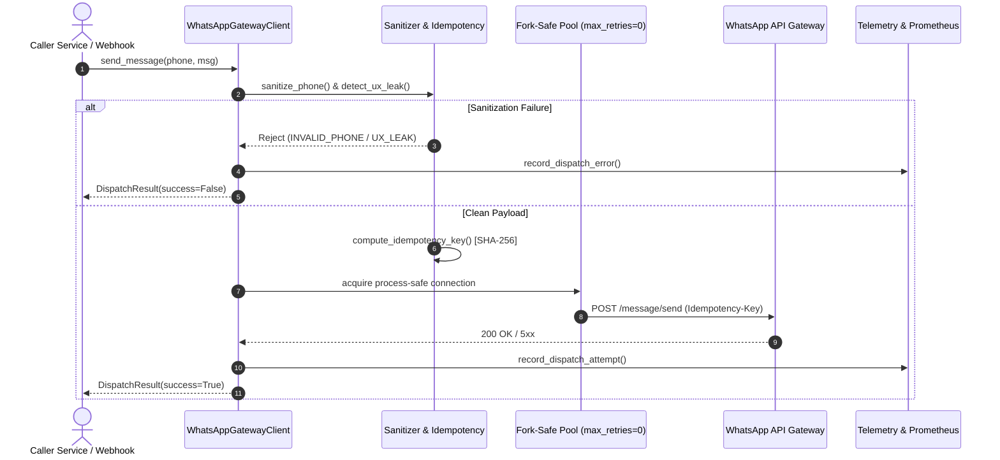

# 📱 whatsapp-ops-gateway

[](https://github.com/emmanuelol/whatsapp-ops-gateway/actions)
[](https://mypy.readthedocs.io/)
[](https://github.com/astral-sh/ruff)
[](https://peps.python.org/pep-0561/)
[](https://opensource.org/licenses/MIT)
[](https://www.python.org/downloads/)

SRE-hardened Python client and gateway primitives for WhatsApp message dispatch. Built specifically for high-concurrency background job workers (Celery, RQ, FastAPI), autonomous agent swarms, and mission-critical alerting where duplicate deliveries or connection leaks cause real-world outages.

---

## 🏗️ Architecture & Message Flow



---

## 🎯 Why This Exists: Systems & SRE Trade-offs

| Problem in Naive WhatsApp Integrations | What Happens in Production | How `whatsapp-ops-gateway` Solves It |
|---|---|---|
| **At-Least-Once Delivery Webhook Duplication** | On-call engineers receive duplicate phone alerts during incident storms. | **Quantized Idempotency:** Deterministic SHA-256 key over 10-minute time buckets (`idempotency.py`). |
| **Connection-Level Multiplicative Retries** | Upstream 503 triggers $3 \times 3 = 9$ amplified HTTP attempts, creating a thundering herd. | **Retry De-amplification:** Transport `max_retries=0` (`session.py`); explicit jittered retries via Tenacity. |
| **Forked Worker Socket Pollution** | Multi-process servers (Gunicorn/Celery) share socket file descriptors across children, corrupting TLS handshakes. | **Process Fork Isolation:** `os.register_at_fork` automatically purges connection pools in child workers (`session.py`). |
| **Accidental Internal Path & UX Leaks** | Raw `/tmp/secrets.json` or markdown media links leak directly into customer WhatsApp chats. | **Active Guardrails:** Regex scanner proactively flags and sanitizes filesystem and UX leaks (`sanitization.py`). |
| **Black-box Failures** | "Message failed" string in logs without actionable root cause. | **Taxonomy & Telemetry:** 13-cause `DispatchErrorCause` enum and native Prometheus metrics (`telemetry.py`). |

---

## ⚡ 30-Second Quickstart

### 1. Installation

```bash
# Using modern uv package manager (recommended)
uv add whatsapp-ops-gateway

# Or standard pip
pip install whatsapp-ops-gateway
```

### 2. Dispatching an Alert

```python
from whatsapp_ops_gateway import WhatsAppGatewayClient

client = WhatsAppGatewayClient()

# SRE alert dispatch (automatically sanitized and deduplicated)
result = client.send_message(
    phone="+52 (472) 699-1461",
    message="🚨 Alert: High memory pressure on db-worker-02 (> 90%).",
    _is_system_alert=True,
)

print(f"Dispatched: {result}")
```

### 3. Observability & Prometheus Metrics

```python
from whatsapp_ops_gateway import get_metrics

# Access in-memory metrics singleton
metrics = get_metrics()

# Render standard text exposition for your /metrics endpoint
print(metrics.render_prometheus())
# Output:
# # TYPE idempotency_hits_total counter
# idempotency_hits_total 12
# # TYPE dispatch_attempts_total counter
# dispatch_attempts_total 158
```

---

## 📊 Micro-Benchmark Performance

Gateway primitives execute in the **sub-microsecond to low-microsecond** range, adding virtually zero overhead:

| Primitive | Throughput | Median (p50) | 99th Percentile (p99) |
|---|---|---|---|
| `sanitize_phone` | ~222,000 ops/s | **2.37 µs** | 10.69 µs |
| `compute_idempotency_key` | ~211,000 ops/s | **3.56 µs** | 11.87 µs |
| `detect_ux_leak` | ~258,000 ops/s | **2.37 µs** | 10.69 µs |
| `metrics.record_attempt` | ~322,000 ops/s | **1.19 µs** | 7.12 µs |

Run local benchmarks yourself:
```bash
python3 benchmarks/benchmark_primitives.py
```

---

## 🛠️ Developer Tooling & Verification

```bash
# Run complete test suite with coverage
make test

# Type checking (mypy --strict, PEP 561 compliant)
make typecheck

# Code formatting & linting
make lint
make format

# Security leak & container vulnerability audit
make audit
```

---

## 📚 Documentation & Governance

- [System Architecture & Sequence Diagram](docs/architecture.md)
- [ADR 0001: Idempotency & Zero Transport Retries](docs/adr/0001-idempotency-and-transport-guarantees.md)
- [Runnable Webhook Consumer Example](examples/webhook_consumer.py)
- [Security Policy & Threat Model](SECURITY.md)
- [Contributing Guidelines](CONTRIBUTING.md)

---

## 📄 License
MIT © 2026 Ops Engineering Team
