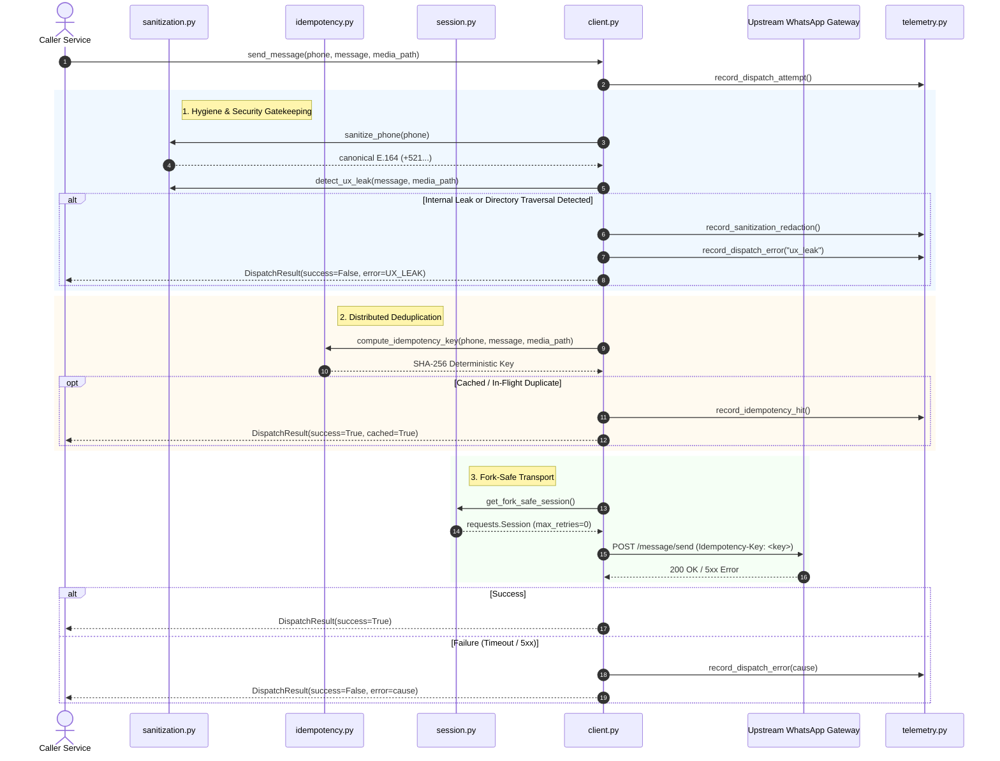

# System Architecture & Operational Invariants

`whatsapp-ops-gateway` is designed as a mission-critical outbound dispatch gateway for operations, alerting, and SRE orchestration. It bridges backend systems with WhatsApp APIs under strict distributed systems constraints.

---

## High-Level Message Dispatch Lifecycle

The sequence diagram below traces an incoming message dispatch request through the internal pipeline:

---

## Core Systems Invariants

### 1. Zero Retry Amplification
Most HTTP client libraries configure connection-level retries by default. When an upstream server experiences high load or 503 errors, connection-level retries turn each request into $N$ requests, causing an exponential thundering herd. 

`whatsapp-ops-gateway` mandates `max_retries=0` on the transport layer (`requests.adapters.HTTPAdapter`). Retries are strictly controlled at the client orchestrator layer using `tenacity` with exponential backoff and full jitter.

### 2. Fork Isolation (Process-Level Safety)
When running inside multi-process WSGI/ASGI servers (Gunicorn, uWSGI, Celery) using `fork()`, child processes inherit the open sockets and connection pools of the parent process. This creates socket corruption, SSL handshake errors, and race conditions.

`session.py` binds to `os.register_at_fork(after_in_child=_reset_session_after_fork)` to force complete teardown and re-creation of connection pools within child workers.

### 3. Time-Windowed Deterministic Idempotency
Webhooks and message queues operate with at-least-once delivery semantics. To eliminate accidental duplicates to user devices, each message generates a deterministic SHA-256 idempotency key:

$$\text{Key} = \text{SHA256}(\text{phone} \parallel \text{sanitized\_msg} \parallel \text{media\_digest} \parallel \lfloor\text{timestamp} / 600\rfloor)$$

Messages with identical payloads within the same 10-minute window map to identical keys, allowing upstream gateways to drop duplicates safely while automatically rotating after window expiry.

### 4. Canonical Error Taxonomy
Failures are mapped to explicit, actionable enum variants (`DispatchErrorCause`):
- `INVALID_PHONE`
- `UX_LEAK`
- `MISSING_TOKEN`
- `SESSION_OFFLINE`
- `HTTP_AUTH`
- `HTTP_SERVER`
- `INVALID_JSON`
- `TIMEOUT`
- `SSL_ERROR`
- `CONN_ERROR`
- `REQUEST_ERROR`
- `GATEWAY_REJECTED`
- `UNKNOWN_ERROR`
